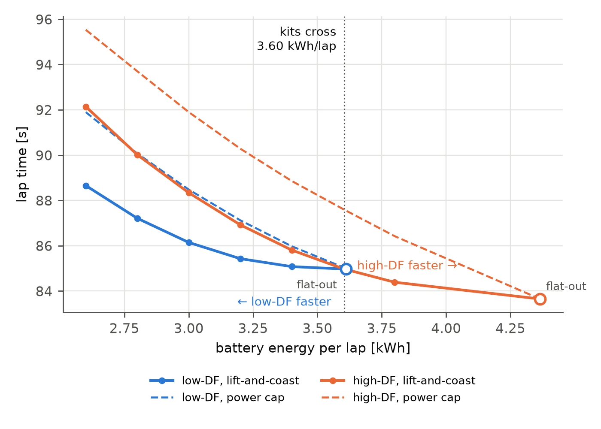

# FE_Energy_LapSim

Quasi-steady-state lap simulation of the Formula E layout at Jarama, calibrated on the
2026 Madrid E-Prix (FP1) and used to project the GEN4 car ahead of the 16–20 November 2026
pre-season test, with an energy-management study (lift-and-coast vs power cap).

**Report (3 pages):** [`report/report.pdf`](report/report.pdf)



## Key results

| | Result |
|---|---|
| Gen3 Evo calibration | One free parameter (tyre μ = 1.689) fitted on the best 350 kW FP1 lap (89.403 s); the 300 kW lap is predicted to within +0.14 s |
| Gen3 Evo energy check | Lift-and-coast lap on the race budget (1.84 kWh/lap): 95.18 s, within the best normal race laps of 4 of 5 drivers checked |
| GEN4, qualifying trim | 80.6 s (600 kW, high-DF), −8.8 s vs Gen3 Evo |
| GEN4, kit choice | High-DF faster on a free lap; **low-DF faster below ≈3.6 kWh/lap**, by 3.5 s at 2.6 kWh/lap. Holds across the tyre and aero assumptions tested |
| Saving strategy | Lift-and-coast meets the same energy budget 0.9–3.6 s/lap faster than capping drive power |

GEN4 aero, tyre grip and efficiencies are **assumptions**; public and assumed inputs are
listed in Table 1 of the report.

## Method

1. **Track:** track limits digitised from satellite imagery, FE loop spliced in;
   centreline 3933 m (official 3934 m); minimum-curvature racing line.
2. **Vehicle:** point mass with aero, longitudinal load transfer, friction circle,
   battery-side power and regen limits, drive/regen efficiencies; FIA minimum masses.
3. **Lap simulation:** cornering limit, backward braking pass and forward traction pass
   on a two-lap domain; lap energy from wheel power net of regen.
4. **Calibration:** tyre μ fitted with `brentq` on the FP1 lap; robustness to drag area,
   mass and front-motor use.
5. **Studies:** GEN4 projection, lift-and-coast vs power cap, sensitivity of the kit conclusion.

## How to run

```
python -m venv .venv
.venv\Scripts\activate          # Windows
pip install -r requirements.txt

python src/run_lap.py           # Gen3 Evo laps, 300 and 350 kW
python src/calibration.py       # fit μ, robustness table
python src/gen4.py              # GEN4 flat-out laps, two kits x two power levels
python src/run_energy.py        # energy study -> results/results.json
python src/sensitivity.py       # kit conclusion vs assumptions
python src/figures.py           # report figures -> report/figures/
pytest                          # tests
```

## Repository

```
src/
  geo.py, check_alignment.py    KML reading, lon/lat -> local x-y, alignment checks
  track.py                      loop splice, centreline, racing line, curvature, load_track()
  vehicle.py                    Car parameters (Gen3 Evo), power modes
  lapsim.py                     QSS lap simulation and energy
  calibration.py                tyre μ calibration on FP1
  gen4.py                       GEN4 definition and projection
  energy.py                     lift-and-coast and power-cap solvers
  run_lap.py, run_energy.py, sensitivity.py, figures.py
test/                           pytest
data/                           track KMLs and sources (see data/README.md)
report/                         LaTeX report, figures, PDF
```

## Data

Track geometry and timing sources are listed in [`data/README.md`](data/README.md).
FIA timing documents are copyright of the FIA and are not included.

## Limitations

Point-mass QSS (no transients or tyre temperature); single μ for both axles; lift-and-coast
uses the same fraction on every straight rather than an optimal allocation; GEN4 values
assumed until test data is available.

Carlos Sánchez Maceda